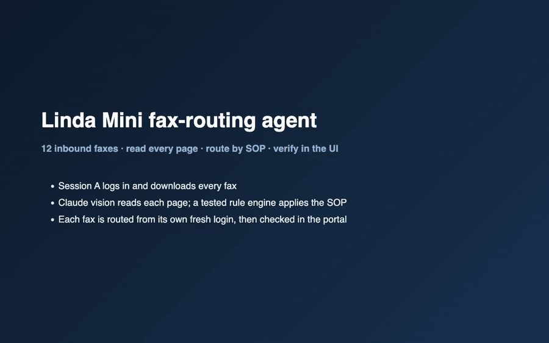

# Linda Mini fax-routing agent

A Playwright worker that does a clinic's fax-routing job the way a person would, through the browser. It logs into the Linda Mini portal, downloads every inbound fax (Session A), and reads every page of the image-only PDFs with Claude vision plus an independent Tesseract cross-check. A pure, tested rule engine applies the routing SOP. Each fax is routed from its own fresh login (Session B), and **every outcome is confirmed by reading the portal UI back**, never from a click or an HTTP response (the one exception is routing notes, which the portal never displays).

It is crash-safe: a durable write-ahead checkpoint means a restart, timeout or 503 never causes a second submit. Anything uncertain goes to Manual Review with a reason.



*45 s, recorded by `make record` from the agent's own browser sessions. Full-quality video: [`results/demo.mp4`](results/demo.mp4).*

## Result on the supplied inbox

| Fax | Read as | Action | Why |
|---|---|---|---|
| FX-201 | referral RF-3001 | routed → Olivia Chen - Referrals | cover sheet + referral |
| FX-202 | lab result LAB-8302 | needs_review | printed flag "CRITICAL RESULT - CALLING PROVIDER" (quoted in the note) |
| FX-203 | imaging report IMG-4003 | routed → Noah Patel - Clinical Review | |
| FX-204 | prior auth PA-4004 | routed → Ethan Brooks | same sender and timestamp as FX-203, different document |
| FX-205 | refill request RX-4005 | routed → Ava Wilson | |
| FX-206 | records request MR-4006 | routed → Mia Gomez | page 2 is its signed release, not a second document |
| FX-207 | EOB EOB-4007 | routed → Liam Rivera | |
| FX-208 | lab result LAB-4008 | needs_review | 1-page report says values are "on following table"; no table follows (see [NOTES](NOTES.md#the-fx-208-call-and-why-it-is-not-fitted-to-one-fax)) |
| FX-209 | unreadable | needs_review | "[SCAN CUT OFF]", continuation page missing |
| FX-210 | referral, resend of RF-3001 | skipped_duplicate of FX-201 | same ID, patient, DOB and category; received later |
| FX-211 | imaging report | already_routed | Routed before the agent ran; read, but never re-routed |
| FX-212 | lab + imaging | needs_review | mixed packet |

Every routed and needs_review fax is `ui_verified`: its routing panel **and** its Routed Documents row match the intended values. The full output is in [`results/sample/`](results/sample/): `results.json`, `results.csv`, `report.html`, `events.jsonl` and one Session B Playwright trace.

## Run it

```bash
# terminal 1: the supplied portal (expects ../linda-mini; override with PORTAL_DIR=...)
make setup        # uv sync + Chromium + the portal's own venv if missing
make portal       # http://127.0.0.1:8000   (add FAULT=download_503_once etc. to inject a fault)

# terminal 2
make demo         # full browser run; extraction replayed from the committed cache (no API key needed)
make run          # same, with live Claude vision on cache misses (ANTHROPIC_API_KEY in .env)
make test         # 130 tests, 24 of them against a real portal
make chaos        # 13 fault / crash / restart scenarios, each on its own throwaway portal
make eval         # score the last run against eval/labels.yaml (my hand labels)
make report       # results/report.html for the last run
make record       # results/demo.mp4 (needs ffmpeg)
```

- **Without `uv`:**
  ```bash
  python3 -m venv .venv
  .venv/bin/pip install -r requirements.txt
  .venv/bin/playwright install chromium
  .venv/bin/python -m agent run --replay    # from the repo root
  ```
  Add `pip install pytest` for the tests.
- **Clean slate:** stop the portal, run `python reset_sandbox.py` in `linda-mini/`, restart it, and add `--fresh` to the agent run.
- **Tesseract is optional** (`brew install tesseract`). Without it, the run says so and the summary warns that the cross-check is off.
- **Replay vs. live:** replay still drives the real portal: it logs in, downloads, routes and verifies. Only the vision call is served from `cache/`, keyed by the downloaded PDF's sha256, the model and the prompt version.

## What the brief asked for, and where it is

| Requirement | Where |
|---|---|
| Runnable code, one command | `make portal` + `make demo` / `make run` (above) |
| README: dependencies, credentials, setup, config, OCR/vision tools | this file; [Tools](#tools-and-why) and [Configuration](#configuration) |
| Per-fax JSON/CSV: ID, type, source ID/evidence, action, fields, verification, errors/retries | [`results/sample/results.json`](results/sample/results.json), [`results.csv`](results/sample/results.csv) |
| Tests / replay: normal routing, an exception, two-session behaviour, retry/uncertain submit | [`tests/test_e2e.py`](tests/test_e2e.py): `test_normal_routing_*`, `test_exception_*`, `test_two_session_*` (including a negative test where routing from the download session gets the portal's 409), `test_uncertain_submit_is_verified_not_resubmitted`, `test_download_503_is_retried`, `test_session_expiry_on_submit_relogs_and_routes_once`, `test_crash_around_submit_then_resume_routes_once`, `test_replay_is_deterministic_across_fresh_portals` |
| Engineering notes: architecture, state/idempotency, failure decisions, known gaps | [`NOTES.md`](NOTES.md) |
| Reliability: download failure, session expiry, uncertain submit, restart | [`results/chaos_matrix.md`](results/chaos_matrix.md), [fault sample](results/sample-fault-commit-then-503/), [table in NOTES](NOTES.md#decision-per-fault-mode) |
| Separate authenticated sessions; matching invariant | one Session A context and a new context per routed fax. The fax ID is asserted on the served download filename (`{fax_id}.pdf`), and on the detail page's heading and Fax ID field in both sessions before acting |
| Do not trust a click or response | every outcome is re-read from the routing panel and the Routed Documents row |

## How it works

```
discover ─▶ download (Session A) ─▶ read every page ─▶ decide (pure rules) ─▶ route (fresh Session B) ─▶ verify in UI ─▶ report
            └──────────── SQLite WAL checkpoint (synchronous=FULL) + flock, written after every transition ───────────┘
```

1. **Discover.** Log in, page through the inbox and record each fax's ID, received time, sender, page count and status. The number of unique IDs must equal the portal's "N transmissions" count.
2. **Download.** Click Download Fax PDF. Keep the file only if it is a real PDF with the expected page count and the name `{fax_id}.pdf`. A 503 page instead of a download is retried with backoff.
3. **Read.** Claude reads each page into a strict schema: type, IDs, patient, DOB, printed flags quoted verbatim, negated flags kept separately, page markers, and references to missing content. Tesseract reads the pages too and can only *escalate* to review, when it clearly contradicts vision.
4. **Decide.** `agent/decide.py` applies the rules in order. The first match wins:
   1. already routed
   2. duplicate
   3. unreadable / wrong document
   4. printed urgency flag
   5. mixed
   6. incomplete
   7. unclear
   8. OCR contradiction
   9. SOP table
5. **Route.** Write the intended route to the checkpoint *before* any click. Then:
   1. open a fresh login and the fax by exact ID, and confirm it is still New;
   2. select the three dropdowns by visible label and read them back;
   3. click Review Routing and check the summary;
   4. click OK.
6. **Verify.** Re-read the fax's routing panel and its Routed Documents row against the intent. A match is the only success.

## Design decisions and tradeoffs

| Decision | Why | Cost / alternative rejected |
|---|---|---|
| **The model transcribes; code decides** | Every routing rule is unit-tested without a browser or key and replayable; the model can't drift into clinical judgment; changing model doesn't change policy (Opus, Sonnet and Haiku made the same 12 decisions) | Less flexible than letting the model choose a route: a new exception type needs a rule. For healthcare routing, predictable beats clever |
| **The UI is the source of truth** | The brief's commit-then-503 fault exists to catch agents that trust responses | About 0.3 s of extra reading per fax |
| **Write-ahead intent + status check before every attempt** | A crash right after OK resumes, finds the fax Routed with the intended values, and records success with no second submit | More states to manage; standard write-ahead-log pattern |
| **When uncertain → Manual Review, always with a reason** | A wrong auto-route is silent; a review is one human glance | Over-review costs staff time, so the eval reports it next to unsafe auto-routes |
| **Fresh login per routed fax** | The portal requires routing from a newer session than the download; per-fax contexts also stop an expired session or stale CSRF token leaking to the next fax | 10 Session B logins in the sample run (one per routed or review fax, ~0.5 s each) instead of one. A single Session B would also satisfy the portal |
| **Browser only: one base-URL `goto`, then clicks** | It is the assignment, and real portals often have no API. `tests/test_boundaries.py` enforces no other `goto`, no `__admin`, no portal DB or seed files, no hard-coded fax IDs | Slower and more selector-dependent than an HTTP client |
| **Duplicates are checked before urgency** | A resend of an urgent fax must be skipped, not turned into a second review task without the first one's context | A resend that *adds* a flag, or whose identity is uncertain, goes to review |
| **Two OCR engines, asymmetric** | Requiring agreement would send every noisy scan to review; Tesseract only flags positive contradictions (negation-aware) | Tesseract is optional; the summary warns when it is off |
| **Committed extraction cache** | A reviewer reproduces the whole run without an API key, still through the portal | Replay does not re-measure perception; `make run` does |

## Evidence

**Reliability**
- `make chaos` ([`results/chaos_matrix.md`](results/chaos_matrix.md)) runs 13 cases, all passing. Each runs against its own throwaway portal and is judged only through the UI. They cover:
  - every fault mode: download 503, session expiry on submit, commit-then-503;
  - `kill -9` at four checkpoints, followed by a resume;
  - a sandbox reset under a stale checkpoint;
  - a genuine 409;
  - an undownloadable fax;
  - a download-time re-login;
  - a second worker on the same checkpoint.
- [`results/sample-fault-commit-then-503/`](results/sample-fault-commit-then-503/): the portal saved FX-201's route but answered 503. The agent re-read the UI and verified the route, with exactly one submit.
- [`FAILURES.md`](FAILURES.md) lists 13 real bugs found while building, by the tests, by adversarial testing and by the model comparison. Each has its root cause, the fix and the test that now pins it.

**Perception (live Claude, measured)**

| Model (live, all 12 faxes) | Same routing decisions as the reference | Unsafe auto-routes | $/fax | Vision p50 |
|---|---|---|---|---|
| Opus 5.5, run 1 / run 2 | 12/12 / 12/12 (0 field diffs) | 0 | $0.034 | 4.4–4.9 s |
| Sonnet 5.5 | 12/12 | 0 | $0.017 | 3.4 s |
| Haiku 5.5 | 12/12 | 0 | $0.0009 | 2.0 s |

From [`eval/model_compare.md`](eval/model_compare.md). This measures agreement and repeatability against the committed Opus extraction, not accuracy against human labels.

- **Damaged PDFs, live vision** ([`eval/perturbation_live.md`](eval/perturbation_live.md)): every auto-routed fax was re-sent with a page blanked or dropped. All 12 variants were detected and sent to review; 0 were auto-routed.
- **Accuracy vs. human labels** ([`eval/report.md`](eval/report.md)):
  - **How the labels were made:** I read all 12 faxes in the portal UI and wrote blind notes. 7 labels are my direct call. The other 5, where my note was unsure or wrong, were settled by applying the SOP with AI assistance; each is marked, with my original note, in [`eval/labels.yaml`](eval/labels.yaml).
  - **Score against the sample run:** **0 unsafe auto-routes, exact-route match 12/12, over-review 0/6, duplicate precision/recall 1.00/1.00.**
  - **Caveats:** n=12 is a smoke test, not an accuracy estimate. FX-208 is the one label that is a policy call rather than a reading (see NOTES). Over-review is reported next to unsafe auto-routes so that sending everything to review can't look "safe".
- **Speed and cost:**
  - **Replay:** about 25 s for the 12 faxes.
  - **Live:** about 5 s of vision per fax, plus browser time.
  - **Opus cost:** $0.41 for the whole inbox, a mean of $0.034 per fax ($0.029 for one page up to $0.060 for three). A replay run spends $0: the cost and vision-latency fields in its results are those recorded when the cache entry was made live.

## Tools and why

- **Playwright (Python, sync API).** It provides real browser contexts for isolated sessions, native download events (a 503 page is told apart from a file by racing the download event against navigation), and traces for debugging.
- **Claude vision (`claude-opus-5-5`, configurable).** The PDFs have no text layer, and every run checks this. It returns structured output validated by a Pydantic schema. Opus is the default for accuracy; the measured comparison above shows Haiku would cut cost about 40× on this inbox.
- **Tesseract via pytesseract, with pypdfium2 for rendering.** It is a free, local, independent second read, and pypdfium2 means no poppler dependency.
- **SQLite (WAL, `synchronous=FULL`) and `fcntl.flock`.** They give a durable checkpoint with no extra service, and a single-worker guarantee.
- **pypdf.** It validates each download and counts its pages.

## Boundaries

- **Navigation:** the only `goto` is the portal's base URL: at start, and for re-entry after a stranded login or an error page. Everything else is clicked.
- **Extraction input** is always the PDF downloaded through the portal, identified by its sha256. Preview screenshots are never used.
- **No clinical inference:** only *printed* flags count, and they are quoted verbatim in the note. Negated statements such as "No urgent flag provided" are not flags.
- **The chaos and demo harnesses** (`harness/`) launch their own throwaway portals with their own `LINDA_DB_PATH`. That is evaluator tooling and never an input to the worker. `tests/test_boundaries.py` asserts that `agent/` imports neither `harness/` nor `tests/`.
- **PHI hygiene:** patient name and DOB are hashed in `events.jsonl` and the console output, even though the data is synthetic. The replay cache and `results.json` keep them in plain text by design, since they are the evidence for each decision.

## Known limitations

These are in more detail in [NOTES](NOTES.md#known-gaps-honest).
- **Routing notes can't be verified in the UI,** because the portal never displays them. They are recorded as sent.
- **Duplicate detection relies on printed IDs plus patient name and DOB.** A resend with a re-keyed ID and no reference to the original would be routed twice.
- **One worker, sequential.**
- **One unreadable fax holds every later-received fax for that run,** because any of them could be its resend. The next run converges.
- **Small sample.** The 12 faxes are synthetic; perception results here are evidence, not a production accuracy estimate.

The production next steps are in NOTES: selector-drift canaries, per-clinic SOP config validated against the live dropdowns, review corrections as regression labels, a per-fax lease queue, and a cheap-model-first cascade.

## Configuration

Settings come from `.env` (gitignored, template in `.env.example`) or the environment; all of them are in `agent/config.py`.

| Variable | Default | Purpose |
|---|---|---|
| `ANTHROPIC_API_KEY` | none | Needed only for live vision |
| `LINDA_BASE_URL` | `http://127.0.0.1:8000` | Portal address |
| `LINDA_USERNAME` / `LINDA_PASSWORD` | training account | Portal login |
| `LINDA_OCR_MODE` | `vision` | `vision` or `replay` |
| `LINDA_VISION_MODEL` | `claude-opus-5-5` | Any Claude vision model |
| `LINDA_WORK_DIR` | repo root | Where `state/`, `downloads/`, `results/` and `runs/` go |

Outputs per run:
- `results/results.json`: for each fax, the extracted type, IDs, evidence, action, reasons, selected fields, the note sent, verification, sessions A and B, submits and recoveries, and tokens and cost.
- `results/results.csv` and `results/summary.md`.
- `runs/<run_id>/events.jsonl` and the Playwright traces.

## Repository layout

```
agent/            the worker: browser.py (sessions, auth, navigation), discover.py, acquire.py (downloads),
                  extract/ (vision, tesseract, cache), decide.py (rules), route.py (submit + verify),
                  state.py (checkpoint, lock), runner.py (orchestration), report.py
tests/            unit, rule-table, boundary, regression and real-portal end-to-end tests
harness/          chaos suite, demo recorder, sample publisher (evaluator tooling, not imported by agent/)
eval/             hand labels, scoring, model comparison, damaged-PDF probe, determinism check
cache/            committed vision extractions (replay without a key)
results/          committed sample runs, chaos matrix, demo video
NOTES.md          design, state machine, per-fault decisions, rule precedence, known gaps
FAILURES.md       bugs found while building: symptom, root cause, fix, pinning test
```
